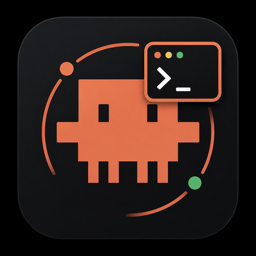

<div align="center">



# Copilot Agent Manager

### See exactly what your Copilot agents — and every subagent they spawn — are doing, **live**, without leaving VS Code

**100% local · read-only · zero config**

</div>

---

> Copilot's chat window shows you the final answer, not the swarm behind it. **Copilot Agent Manager** turns the session events Copilot already writes into a calm, live dashboard — the full agent tree, what each agent is doing *right now*, what it changed, what it cost, and every session you've ever run — searchable in a keystroke.

---

## Why you'll want it

- 👀 **Never lose track of a subagent again.** A live tree shows the main agent → every subagent it spawns, with status, current tool, and progress.
- 🧭 **Understand a run at a glance** instead of scrolling a chat transcript.
- 🔎 **Find any past session by what was said in it** — across every project — and resume it in one click.
- 💎 **Native and safe.** Pure VS Code styling, read-only, all on your machine. It never touches your running sessions.

---

## ✨ Features

### 🌳 Live agent & subagent tree

Your whole run, structured. The main agent with the subagents it spawned nested underneath — names and tasks pulled straight from Copilot's `subagent.started` events. Spinners for running, badges for `done` / `error` / `waiting`, token counts, and progress only when Copilot actually reports todos (never a fake bar).

### ⚡ "Right now" — the current tool call

For every running agent, see the exact tool in flight (`edit src/auth/session.ts`, `bash npm test`, `grep …`) plus a **live streaming activity log** that updates as it works.

### 💬 VS Code chat sessions, too

Editor chats live in VS Code's own Copilot store (`session-store.db`), not in the CLI session tree. Copilot Agent Manager reads that SQLite store directly — recent turns included, even while they still only exist in its write-ahead log — and lists those sessions next to CLI ones. They expose their turns and the **files they referenced** (`session_files`), but no tool stream and no subagents, so **Continue** stays hidden for them.

### 🔍 Search every session (full-text)

Hit the **search** icon and type a keyword. The extension scans the full text of **every Copilot session's events** with ripgrep — sub-second — and returns matching sessions (subagent hits folded in), each with a highlighted snippet. Then **Continue** or **Read** it in one click.

### ▶️ Continue any session

Pick up right where a session left off: **Continue** opens a terminal in the session's project and runs `copilot --resume=<session-id>`.

### 📂 Session-wide changes

One combined, PR-style view of **every file the whole run touched** — across the main agent and all subagents — with `+/−` counts and one-click diffs of exactly what changed.

### 📖 Readable conversations (not raw JSONL)

Open any agent's conversation as a **clean, formatted Markdown view** — prompts, replies, and tool calls — instead of squinting at `events.jsonl`.

### 🖥️ Sidebar *or* full-screen editor

Live in the activity bar, or pop the whole dashboard out into a **full-screen editor tab** — both stay in sync.

### 🎛️ Three layouts, one click

Switch between **Tree** (hierarchy + inline detail), **Cards** (one live card per agent), and **Split** (master list + Activity / Files / Conversation tabs).

### 🔔 Status bar + finish notifications

A glanceable status-bar chip (`✦ 2 running · 1.2M tok`) even when the panel is closed, plus a toast when an agent **finishes** or **errors**.

---

## 🚀 Getting started

1. **Install** Copilot Agent Manager from the Marketplace (or `code --install-extension copilot-agent-manager-x.y.z.vsix`).
2. Click the **Copilot Agent Manager** icon in the activity bar.
3. Run Copilot as usual — agent mode in VS Code or the Copilot CLI, ideally a task that spawns subagents — and watch it light up. ✨

> 🔎 **Seeing nothing?** First open is scoped to your current workspace. Click the **scope toggle** in the header (or run **“Copilot Agents: Toggle Scope”**) to show **all projects**.

No setup, no API keys, no sign-in. It reads the session events Copilot already writes under `~/.copilot/session-state`, plus VS Code's own chat store (turn that off with `includeChatStore`).

---

## ⚙️ Settings

All under `copilotAgentManager.*`:

| Setting | Default | Description |
| --- | --- | --- |
| `copilotHome` | `""` | Override the Copilot home dir (else `COPILOT_HOME` → `~/.copilot`). |
| `scope` | `workspace` | Monitor the current folder only, or **all** projects. |
| `includeChatStore` | `true` | Also read VS Code's Copilot Chat store (`session-store.db`). |
| `defaultLayout` | `tree` | `tree` · `cards` · `split`. |
| `accent` | `clay` | Accent color (`clay` or `blue`). |
| `notifyOnFinish` | `true` | Toast when an agent finishes or errors. |
| `activeThresholdSeconds` | `45` | Session events touched within this window count as *running*. |
| `maxSessions` | `6` | Most recent sessions to monitor. |
| `maxLogLines` | `200` | Log lines kept per agent. |
| `pollSeconds` | `4` | File-watch fallback poll interval. |

---

## 🛡️ Private & safe by design

- **Read-only.** It observes the session events Copilot already writes and opens VS Code's chat database read-only — it never sends input to, pauses, or interferes with your agents.
- **100% local.** No network calls, no telemetry, no accounts. Your conversations never leave your machine.
- **Fast on huge runs.** Multi-megabyte session files are tail-read incrementally, never loaded whole in the hot path.

<details>
<summary><b>How it works</b></summary>

```
~/.copilot/session-state/<sessionId>/
  events.jsonl       ← every session event: prompts, messages, tool calls, subagents
  workspace.yaml     ← cwd, git branch, session name
  session.db         ← todos / inbox
```

Each `events.jsonl` line is one event. The interesting ones:

| Event | Meaning |
| --- | --- |
| `session.start` · `user.message` · `assistant.message` | conversation turns |
| `tool.execution_start` / `tool.execution_complete` | a tool call and its result |
| `subagent.started` / `subagent.completed` | a subagent being spawned and finishing |
| `session.usage_record` | tokens per model call |
| `session.task_complete` · `session.error` | how the run ended |

Tool events produced by a subagent carry an `agentId`, and `subagent.started` is itself spawned by a `task` tool call — so the extension rebuilds a real parent/child tree instead of guessing. Status and progress are *derived* from events (Copilot writes no status field), so they are heuristic and tunable via settings.

Editor chat sessions are stored separately, by VS Code:

```
…/User/globalStorage/github.copilot-chat/session-store.db
  sessions       ← id, cwd, repository, branch, summary, agent name, timestamps
  turns          ← one row per exchange (user message + assistant response)
  session_files  ← files the session touched, with the tool that touched them
```

That file is read without any native dependency: a small read-only SQLite reader parses the database format itself and replays committed `-wal` frames, so a chat that just finished shows up immediately. It is located from the running VS Code's own storage path, so a custom `--user-data-dir` or a portable install resolves correctly. Those rows carry no tool calls or subagent events, so each appears as a single agent for the session; sessions whose turns have no text at all are hidden.
</details>

---

## ❓ FAQ

**Does it work without any setup?** Yes — if Copilot writes sessions to `~/.copilot/session-state`, it just works.

**Which Copilot surfaces are covered?** Copilot CLI and VS Code's Copilot CLI runtime (full events, subagents, diffs, resume), plus VS Code's own Copilot Chat store for editor sessions (turns only, no tool stream). Set `copilotAgentManager.includeChatStore` to `false` to ignore the database.

**Can it control or stop my agents?** No, by design. It is a read-only monitor; **Continue** launches a fresh resume via `copilot --resume`, it never injects into a live run.

**Does it send my data anywhere?** Never. Everything stays on your machine.

---

## 📄 License

[MIT](LICENSE) © Damilola Onadeinde

<div align="center">

**If Copilot Agent Manager makes your agent runs clearer, please ⭐ the repo and leave a Marketplace review!**

</div>
